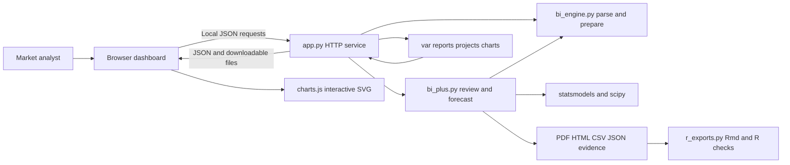
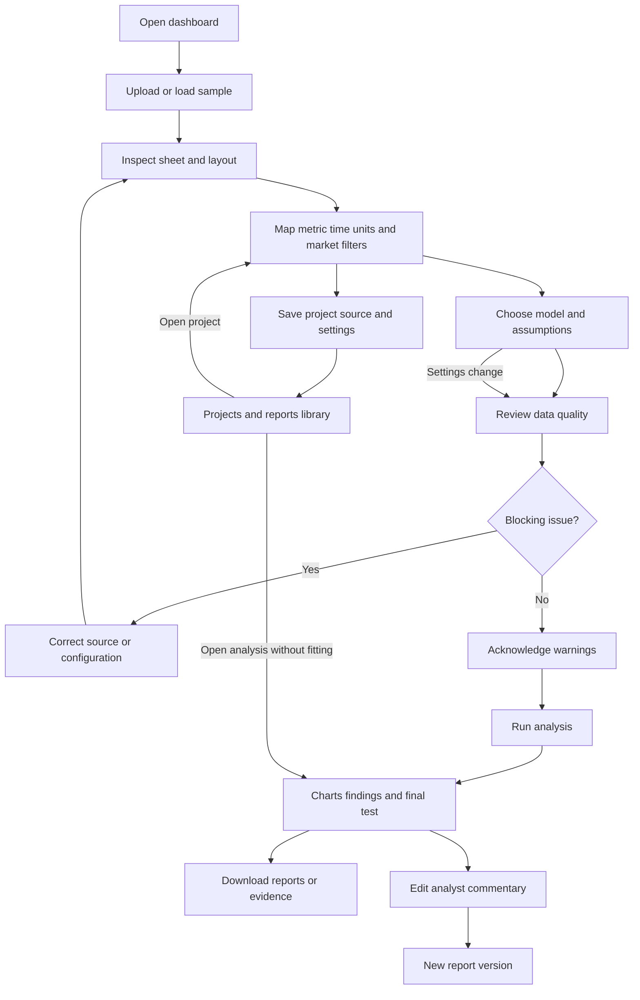
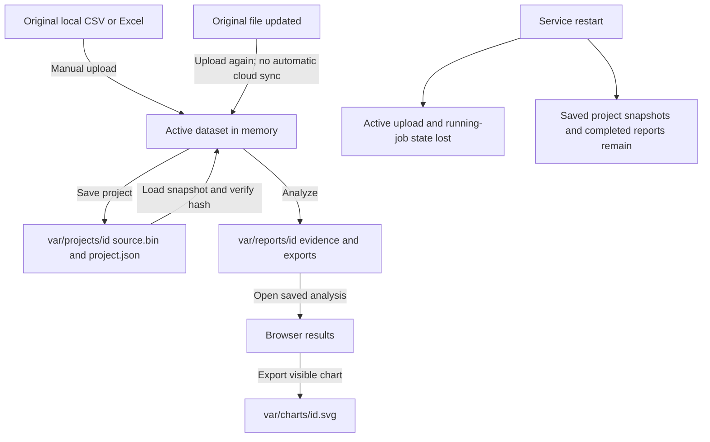
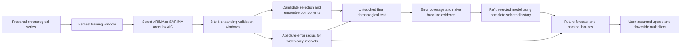
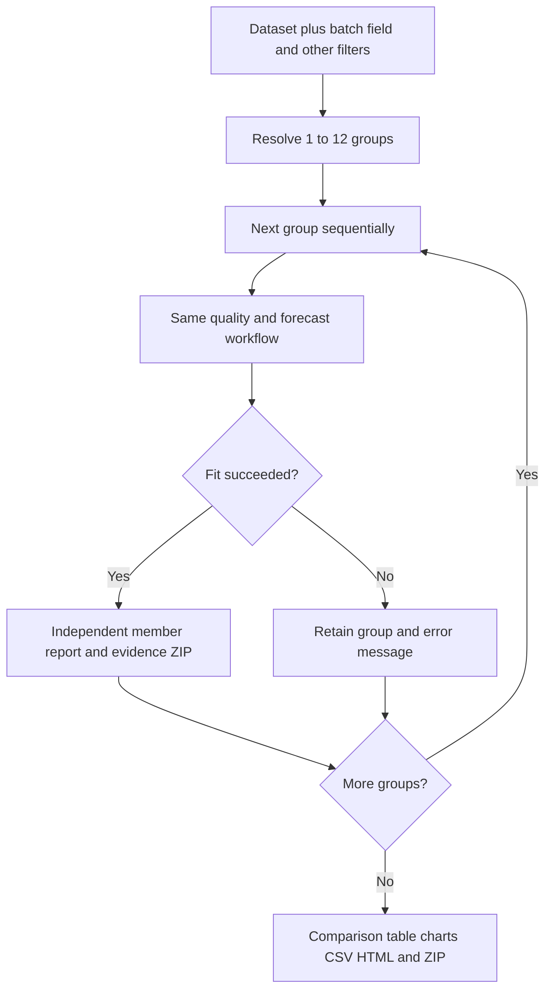
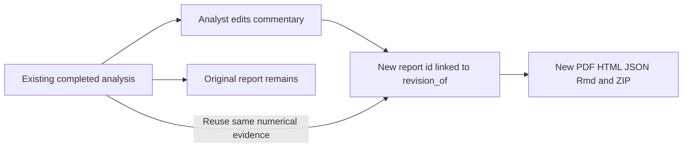
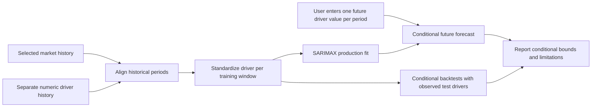
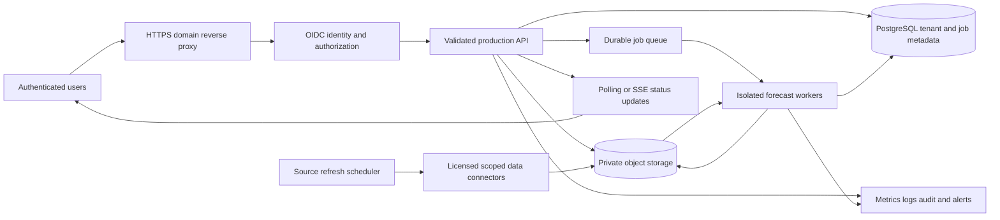

# Alphacentauric Business Intelligence — hosted release 1.1

A functional forecasting dashboard with real Kaggle retail data, CSV/Excel uploads, 13 named models, model comparison, interactive charts, scenarios and downloadable evidence reports. **No paid AI calls or API keys are required.**

**Production:** https://alphacentauric-bi.vercel.app

Repository: https://github.com/Gayatri2502/alphacentauric-business-intelligence-time-series

Start with the [hosted application guide](docs/HOSTED.md) for the current deployment architecture, beginner usage, execution commands, Kaggle provenance, data/navigation diagrams, tests and commercial boundaries. [Data attribution](THIRD_PARTY_DATA.md) records the source license.

Hosted projects/reports are saved in this browser's IndexedDB and can be downloaded. They are not synchronized across devices. Uploads are processed in a request-scoped temporary directory. The Kaggle sample is historical 2015–2018 retail data, not a live market feed or 2026 market forecast.

The original local dashboard and its detailed guide follow below. Its file storage, local-account mode and deployment roadmap describe the persistent local/server edition; use `docs/HOSTED.md` for the Vercel edition.

---

# Alphacentauric Business Intelligence

**Turn dated market data into inspectable forecasts, interactive charts and evidence-backed reports.**

A local application for market researchers, business analysts and ML engineers. Upload CSV or Excel data, select a market and model, review data quality, test forecasts against past observations, explore scenarios, and export reports for Python or R review.

**Release status:** working single-user local application, organized for maintenance and a future deployment migration. It is not yet a public multi-user SaaS. Docker and CI configurations are included as starters; the production integrations described below are not implemented. Forecasts are estimates, not proof of future market outcomes.

**Cost:** forecasting runs on your computer. No OpenAI API key, API model, token recharge, cloud account or paid connector is required. Installing Python dependencies needs an internet connection once. Cloud hosting and optional third-party services would have their own costs if you later integrate them.

## Contents

1. [Objective and problems solved](#objective-and-problems-solved)
2. [What is implemented](#what-is-implemented)
3. [Project structure](#project-structure)
4. [Beginner setup](#beginner-setup)
5. [First successful analysis](#first-successful-analysis)
6. [Your own data and values to replace](#your-own-data-and-values-to-replace)
7. [Application guide](#application-guide)
8. [Architecture and flow diagrams](#architecture-and-flow-diagrams)
9. [Outputs and reproducibility](#outputs-and-reproducibility)
10. [R and RStudio](#r-and-rstudio)
11. [Validation and scientific limits](#validation-and-scientific-limits)
12. [Deployment roadmap and integrations](#deployment-roadmap-and-integrations)
13. [Testing and troubleshooting](#testing-and-troubleshooting)

## Objective and problems solved

Market spreadsheets often mix countries, states, sectors, units and periods. Analysts need to choose a meaningful series, detect data problems, compare methods and communicate uncertainty. This application creates a repeatable workflow from those spreadsheets to an auditable report.

| Problem | How the project addresses it | Boundary |
|---|---|---|
| Dates may run down rows or across columns | CSV/Excel inspection and wide-to-long reshaping | First row must contain headings; ambiguous layouts need manual mapping |
| Many markets share one spreadsheet | Explicit categorical filters and independently forecasted batch groups | Geography is taken from uploaded labels; no global market database is fetched |
| Poor data can create false results | Mandatory quality review, missing-value/date rejection, mixed-unit blocks and visible warnings | Publisher authenticity is not independently verified |
| A single model can look convincing | ARIMA/SARIMA and additional model comparisons, naive baseline, chronological testing | Supported algorithms are a defined set, not every time-series model |
| Point forecasts hide uncertainty | Nominal intervals, observed coverage, widen-only calibration and explicit limits | Coverage is not guaranteed; selection, shocks and driver uncertainty remain limitations |
| Business assumptions need explanation | User-controlled scenarios, evidence register and explanatory side column | Scenario paths are assumptions, not estimated probabilities |
| Analysts need reusable deliverables | PDF/HTML/CSV/JSON/R Markdown, R checks and evidence ZIP | R exports check selected evidence; they do not independently refit Python models |

Typical inputs include dated market size, revenue, unit sales, demand or production. Rates/shares/indices can be analyzed with appropriate aggregation, but they do not receive a CAGR-of-CAGR calculation. A single CAGR number, a list of countries without dates, or a few annual observations cannot support a defensible time-series forecast.

## What is implemented

- Dark glass dashboard with source controls, graphical results and a methods/evidence side column.
- UTF-8 CSV, XLSX and XLS; Excel sheet selection and years/dates across columns.
- Time/value mapping; country, state, region, sector, segment and other categorical filters.
- Daily, weekly, monthly, quarterly and annual aggregation using sum, mean or last.
- Data-quality review: missing/bad values, repeated time labels, duplicates, mixed units, outlier screening, potentially overlapping totals and source provenance.
- Thirteen selectable families: ARIMA, SARIMA, Holt-Winters, Holt, Theta, Naive, Seasonal naive, Drift, ETS, Seasonal Theta, STL-ARIMA, Ensemble and SARIMAX.
- Compare all: twelve driver-free candidates, with visible failed/unsupported candidates; SARIMAX is selected separately with a driver.
- Three to six expanding validation windows plus a separate untouched final test; metrics and lead-wise errors.
- Optional widen-only interval adjustment from rolling errors, upside/downside scenarios and descriptive regime screening.
- Six interactive chart views with hover/tap values, legend toggles, sliders, zoom/pan, expansion, keyboard navigation, data tables and SVG downloads.
- Batch comparisons for up to twelve groups, saved local source/configuration snapshots, saved reports and new analyst-commentary versions.
- Self-contained R Markdown and R verification-script exports with embedded evidence.

## Project structure

```text
alphacentauric-business-intelligence/
├── README.md                     # Start here: objective, setup, use, diagrams, roadmap
├── run.py                        # Beginner launcher for the source checkout
├── pyproject.toml                # Installable package, version, entry point and assets
├── requirements.txt              # Direct dependencies plus runtime constraints
├── requirements.lock.txt         # Complete tested runtime-version constraints
├── .env.example                  # Optional settings; no credentials required
├── .gitignore / .dockerignore    # Exclude environment, generated data and secrets
├── CHANGELOG.md / SECURITY.md    # Release notes and local/public deployment boundary
├── compose.yaml                  # Local Docker deployment starter
├── deploy/Dockerfile             # Python 3.12 container starter
├── .github/workflows/tests.yml   # CI test workflow starter
├── src/alphacentauric_bi/
│   ├── __init__.py / __main__.py  # Package version and module entry point
│   ├── app.py                    # Local HTTP routes, jobs, projects and downloads
│   ├── bi_engine.py              # Parsing, preparation, baseline models and PDF/HTML export
│   ├── bi_plus.py                # Quality review, advanced models, validation and scenarios
│   ├── r_exports.py              # R Markdown and R verification generation
│   ├── static/bi.html            # Dashboard structure and visual theme
│   ├── static/workspace.js       # Review, projects, results and analyst commentary
│   ├── static/charts.js          # Interactive SVG charts
│   └── data/                    # Packaged synthetic sample and evidence requirements
├── examples/
│   ├── market_sample.csv         # Synthetic example you can upload yourself
│   └── config.sample.json        # Explained API configuration example, not auto-loaded
├── tests/                        # 21 automated forecasting/export tests
├── docs/
│   ├── ARCHITECTURE.md            # Modules, endpoints, storage and synchronization
│   ├── DATA_GUIDE.md              # Input contracts, mapping and example values
│   ├── DEPLOYMENT.md              # Local Docker and proposed market deployment
│   ├── VERIFICATION.md            # What was tested and what remains unverified
│   └── diagrams/*.mmd            # Standalone editable Mermaid diagrams from this README
└── var/
    ├── reports/                  # Generated analyses, revisions and batch reports
    ├── projects/                 # Saved original source bytes and configuration
    └── charts/                   # Generated downloadable SVGs
```

The ZIP includes code, tests, documentation, configuration and synthetic examples. It excludes actual uploaded data, previous analyses, credentials, installed environments, caches and generated exports. `var/` starts empty. Do not replace source files with your Excel/CSV input; use the upload control.

## Beginner setup

### 1. Extract and install Python

Extract the ZIP. Open the folder named `alphacentauric-business-intelligence`, then open a terminal **in that folder**. Install Python **3.12** if it is missing. This release is tested on Python 3.12 and its package metadata limits installation to that version family.

Check it:

```sh
python3.12 --version
```

On Windows, use `py -3.12 --version`. Commands below assume you are inside the project folder, where `run.py` and `requirements.txt` are visible.

### 2. Create a private environment and install libraries

macOS / Linux:

```sh
python3.12 -m venv .venv
source .venv/bin/activate
python -m pip install -r requirements.txt
python run.py
```

Windows PowerShell — activation is optional, so these commands avoid script-policy issues:

```powershell
py -3.12 -m venv .venv
.\.venv\Scripts\python.exe -m pip install -r requirements.txt
.\.venv\Scripts\python.exe run.py
```

The `.venv` folder is generated on your computer; it is deliberately absent from the ZIP. Dependency installation may take several minutes. Do not paste placeholder text or Markdown fence markers into the terminal.

### 3. Open and stop the application

Open [http://127.0.0.1:8000](http://127.0.0.1:8000/) in your browser. Leave the terminal running. Stop with **Control-C** in the terminal.

If another service uses port 8000:

```sh
python run.py --port 8001
```

Then open `http://127.0.0.1:8001/`. On Windows, replace `python` with `.\.venv\Scripts\python.exe` when not using an activated environment.

### 4. Run it again later

macOS/Linux: open a terminal in the project folder, run `source .venv/bin/activate`, then `python run.py`. Windows: run `.\.venv\Scripts\python.exe run.py`. You do not reinstall requirements every time.

### Optional developer installation

After activating the environment, `python -m pip install -e .` installs the package in editable mode. You can then use `alphacentauric-bi` or `python -m alphacentauric_bi`. These entry points use `var/` under the current working directory unless `BI_DATA_DIR` is set; `python run.py` consistently uses the project folder's `var/`.

## First successful analysis

1. Click **Load synthetic market sample**. The sample represents generated data, not real market evidence.
2. Confirm Time field `date`, Value `market_size_usd_million`, units `USD million`, and the selected Germany/Bavaria/Europe solar segment.
3. Use Monthly frequency and **Mean** aggregation for this example. Select **SARIMA**, horizon `12`, season `12`, nominal interval `95`, and three rolling windows.
4. Click **Review data quality**. Read the findings, then check the acknowledgement box. If the review blocks analysis, fix the mapping, filters or input first.
5. Click **Analyze market & forecast**. Wait for local fitting and report generation.
6. Inspect **History & forecast**, **Scenario paths**, the comparison chart and **Untouched final test**. Read the methods side column and limitations.
7. Expand a chart, inspect values, hide/show a series, adjust its range and download an SVG. This uses existing results and does not refit models.
8. Download a PDF or **Full evidence bundle**. Save the project if you want to retain its source bytes and settings after restart.

No configuration file, API key or account has to be generated before this example works.

## Your own data and values to replace

### CSV example

```csv
date,country,state,sector,segment,market_size,currency
2020-01-01,India,Maharashtra,Renewable energy,Solar,100,USD
2020-02-01,India,Maharashtra,Renewable energy,Solar,103,USD
2020-03-01,India,Maharashtra,Renewable energy,Solar,105,USD
```

These three example rows explain the schema; they are **not enough to forecast**. Supply at least twenty regular historical periods, and more for seasonal models and the requested test windows. Include a header row and unambiguous dates, preferably `YYYY-MM-DD`. Values must be finite numbers; place currency/units in separate metadata fields instead of values such as `$1,000m`.

Excel long layout uses the same fields. Wide layout can have identifiers such as country/metric in the first columns and years such as `2020`, `2021`, `2022` across columns; select **Years across columns** and map generated `_period`/`_value`. Filter a metric-name identifier to one metric when several measures occupy rows.

| Input / setting | Replace with | Example | Required? |
|---|---|---|---|
| Uploaded file | Your dated CSV/XLSX/XLS | `solar_market_history.xlsx` | Yes, or use sample |
| Worksheet/layout | Actual sheet and orientation | `Market history`, dates down rows | For Excel/layout-dependent |
| Time field | Your period/date column | `month` | Yes |
| Value field | One numeric metric | `revenue_usd_million` | Yes |
| Filters | A consistent market definition | country=India, segment=Solar | When dimensions vary |
| Units and metric meaning | Actual currency/unit; level versus rate/index | USD million, level | User must confirm |
| Aggregation/frequency | Meaningful measure aggregation | monthly mean for snapshots | Yes |
| Model/season/horizon | Research choice and sufficient history | SARIMA / 12 / 12 | Yes |
| Source evidence | Publisher, citation, date and methodology | Your actual dataset citation | Strongly encouraged |
| SARIMAX driver | Separate numeric historical field and future assumptions | price_index; 12 future values | Only for SARIMAX |
| Scenario adjustments | Conditional annual multipliers | +5%, -5% relative to baseline | Defaults exist |
| Project name | A descriptive saved investigation name | India solar baseline | Only when saving |
| BI_DATA_DIR | Optional writable absolute storage path | `/home/me/bi-data` | No; defaults exist |
| BI_PORT | Optional free local port | 8001 | No; default 8000 |

There are **no API keys to replace**. `examples/config.sample.json` documents the local API settings; the browser does not automatically load this file. Keep `review_accepted` false until findings have been reviewed. Native Python does not read `.env` automatically; set environment variables in your terminal or use CLI flags. Docker Compose reads a root `.env` if you choose to copy `.env.example`.

Detailed input rules, interpretation and limits: [docs/DATA_GUIDE.md](docs/DATA_GUIDE.md).

## Application guide

**Source:** upload and inspect; choose Excel sheet/layout. Inspection replaces the active in-memory dataset. It does not overwrite previous project snapshots or reports.

**Define the market:** map columns and filter categorical dimensions. Unfiltered varying dimensions require explicit consent to combine. Mixed units/currencies block analysis. Do not combine a global total with the country components that already make up that total.

**Models and review:** select the model first. Changing settings invalidates the quality acknowledgement, so review again. Missing source values/bad dates require correction; missing periods may be explicitly carried forward from past data. Outliers are flagged and retained.

**Results:** use six graphical views, the model table and the final-test evidence. Controls work by transforming the visible chart view, not by regenerating a forecast. A chart download preserves the visible range and series. Escape closes an expanded chart.

**Comparisons:** expand Batch market comparison, choose a dimension, clear filters when appropriate, review, then analyze. Up to twelve groups run sequentially. Other dimensions still apply. Each group has its own report; failures are listed. A comparison ZIP includes member evidence ZIPs.

**Library:** save source/settings from the workspace and reopen from Saved projects & reports. Reopening a project restores its snapshot, not an external live source. Opening an analysis displays saved results without re-running a model. Changing the original spreadsheet requires a new inspection and a new analysis.

**Commentary:** edit analyst commentary and generate a new report version. Existing results and previous versions are retained; commentary is clearly labeled analyst-authored.

**Behind the analysis:** inspect preparation choices, model parameters, validation, uncertainty, source register, findings and limits. This is the evidence trail, not an autonomous web research agent.

## Architecture and flow diagrams

Diagrams below use Mermaid. Compatible Markdown viewers render them; standalone `.mmd` files are in [docs/diagrams](docs/diagrams). If your viewer shows code instead of diagrams, use a Mermaid-capable editor or renderer. All diagrams distinguish existing behavior from planned integrations.

### 1. Current component architecture



### 2. User navigation and review gates



### 3. Browser/service data and job synchronization

```mermaid
sequenceDiagram
  actor Analyst
  participant UI as Browser
  participant API as Local HTTP service
  participant RAM as Process memory
  participant Worker as Forecast thread
  participant Disk as Local var folder
  Analyst->>UI: Select file and inspect
  UI->>API: POST /api/datasets (base64 bytes and layout)
  API->>RAM: Replace active dataset; retain source bytes
  API-->>UI: Dataset id, fields, categories and preview
  Analyst->>UI: Set model, filters and assumptions
  UI->>API: POST /api/review
  API-->>UI: Blocking issues and warnings
  Analyst->>UI: Acknowledge findings and analyze
  UI->>API: POST /api/jobs
  API->>RAM: Create running job id
  API->>Worker: Start one background analysis
  API-->>UI: Job id
  loop Approximately every 1.2 seconds while running
    UI->>API: GET /api/jobs/id
    API-->>UI: Status and stage
  end
  Worker->>Disk: Write evidence and reports
  Worker->>RAM: Mark completed or failed
  API-->>UI: Final results and file names
  UI->>API: GET /api/jobs/id/charts
  API->>Disk: Read selected history and backtests
  API-->>UI: Chart evidence JSON
  Analyst->>UI: Zoom, expand or toggle chart series
  Note over UI: Interaction uses saved results; no new model fit
```

### 4. Storage and source refresh behavior



### 5. Forecast validation and final production refit



The final test is excluded from order search, candidate selection and interval calibration. After testing, its observations become part of the final production fit. Long requested horizons may exceed the historically tested lead lengths.

### 6. Batch market comparisons



### 7. Analyst report revisions



### 8. Conditional SARIMAX driver flow



Observed test drivers may not have been known at prediction time. Their conditional test accuracy does not establish real-time deployable accuracy, and future driver uncertainty is omitted from the intervals.

### 9. Proposed public deployment — not implemented



## Outputs and reproducibility

| File / folder | Purpose |
|---|---|
| `var/reports/<id>/report.pdf` | Portable analyst report |
| `report.html` | Browser-readable report |
| `report.Rmd` | Editable, self-contained R Markdown report |
| `verification.R` | Independent R checks on exported evidence |
| `history.csv` | Selected prepared series actually fitted |
| `forecast.csv` | Point forecasts, intervals and scenario paths |
| `backtest.csv` | Rolling/final predictions, observations, dates and partition labels |
| `findings.json` | Settings, source hash, model parameters, metrics and limitations |
| `forecast.svg` | Static forecast chart for evidence |
| `report.zip` | Report files, both engines, R export helper, requirements and rerun script |
| Batch `market_comparison.csv`, `comparison.html`, `comparison.zip` | Comparison evidence and member report bundles |
| `var/projects/<id>/source.bin`, `project.json` | Saved original file bytes, source hash and settings |
| `var/charts/<id>.svg` | User-exported visible chart view |

The evidence ZIP excludes the original upload. To reproduce an analysis, extract that ZIP, create a Python 3.12 environment, install its requirements, then run `python rerun.py /path/to/original-file` **from the extracted evidence folder**. Replace the path with your original file. The helper verifies its SHA-256 before rerunning and writes `rerun-output/`. Runtime dependencies are constrained to the tested versions, but hardware/numerical optimizer differences can still affect fitted values.

`var/` is generated automatically. Preserve it when moving/upgrading the source checkout. Migrating this structured package from an older workspace requires copying `dashboard-runs/` into `var/reports/`, `projects/` into `var/projects/`, and `chart-exports/` into `var/charts/` while the app is stopped; those user files are not part of this release ZIP.

## R and RStudio

R is optional; Python forecasting works without it. To knit R Markdown, install R, RStudio or another R editor, `rmarkdown`, `jsonlite`, and Pandoc. RStudio supplies an integrated knitting workflow; see the [official R Markdown introduction](https://rmarkdown.rstudio.com/lesson-1.html).

Run once in your R console if the packages are missing:

```r
install.packages(c("rmarkdown", "jsonlite"))
```

Download `report.Rmd` and open it in RStudio, then click Knit, or run:

```r
rmarkdown::render("report.Rmd")
```

Replace the quoted filename with an absolute path when it is in another directory. The R Markdown file embeds selected observations, predictions and metadata, so companion CSVs are not required for knitting. It includes plots, ACF of levels/differences, model settings, analyst notes and evidence checks.

For the script: `Rscript verification.R` requires jsonlite. Checks recompute MAE, RMSE, sMAPE, coverage, applicable CAGR, final-test naive baseline and MASE, and inspect chronology, finite values and interval ordering. Failures produce a warning; inspect them before using the report. These are checks of exported evidence, not independent source verification or a claim that R and Python estimators produce identical fits. R code is exported for local use, not executed on the dashboard server.

R is unavailable on the build machine, so R execution/knitting remains unverified. See [docs/VERIFICATION.md](docs/VERIFICATION.md) for tested boundaries.

## Validation and scientific limits

ARIMA/SARIMA orders are chosen on the earliest training window. Candidate selection and ensemble construction use rolling results, so those errors can be optimistic. A separate final test provides additional evidence before complete-history refitting. Explicit model selection is respected; failed models are not silently substituted.

Intervals have model-specific assumptions or labeled approximations. Calibration pools rolling absolute errors and only widens bands; serial dependence and short samples prevent guaranteed nominal coverage. Ensemble bounds are a component envelope, not a calibrated probability interval. Small-sample coverage should not be described as proof. Check the tested lead lengths before extrapolating a long horizon.

CAGR is positive-endpoint annualized growth over elapsed calendar time. Projected CAGR is derived from a model endpoint. Descriptive break screening is not a statistical structural-break test. Scenario multipliers are meaningful for positive levels; avoid treating them as growth forecasts for negative levels or rate/index measures.

## Deployment roadmap and integrations

The supplied application is ready for local use and further engineering. Commercial/public deployment requires additional work. [docs/DEPLOYMENT.md](docs/DEPLOYMENT.md) contains the detailed implementation order and integration responsibilities.

| Capability | Current release | Required/proposed market integration |
|---|---|---|
| Serving | Python stdlib local HTTP server | Production API framework, validated schemas, controlled request limits and timeouts |
| Identity | Single local user | OIDC identity provider; roles, tenant authorization and session handling |
| Metadata | Process memory plus JSON files | PostgreSQL schema and migrations; durable dataset/job/report relationships |
| Files | Local folders | Private object storage, encrypted retention, checksums and controlled downloads |
| Long jobs | Daemon thread; one active analysis | Durable queue and isolated workers; quotas, cancellation, retries and job recovery |
| Delivery | Local JSON polling | Authenticated status polling or SSE; scoped downloads and failure visibility |
| Transport | Loopback HTTP | Domain, HTTPS termination and certificate renewal |
| Market sources | User uploads | Licensed connectors with scoped credentials, provenance, refresh/versioning and reconciliation |
| Validation | 21 automated tests and inspected local flows | Larger benchmark suite, source revision handling, horizon/segment-specific monitoring and independent methodological review |
| Operations | Manual launcher; Docker/CI starters | Managed deployment, backups/restore drills, structured logs, metrics, alerts and dependency/container scanning |
| Privacy/legal | Local files; synthetic demo in ZIP | Access logs, retention/deletion, customer terms, data rights and legal review appropriate to target market |
| Product | Research workspace | Collaboration, approval workflows, localization, accessibility audit, billing only if needed, and support processes |

One possible stack is FastAPI/Uvicorn for the API, PostgreSQL for metadata, S3-compatible private object storage, Redis/Celery for queued work, an OIDC provider for identity, and an HTTPS reverse proxy such as Caddy. These are proposed components, not existing integrations. Select alternatives based on operating skills and scale. Do not add several web workers to the current in-memory app: they would not share uploads/jobs. The [FastAPI deployment concepts](https://fastapi.tiangolo.com/deployment/concepts/) describe HTTPS, process management, restarts and replication concerns.

For local containers, with Docker and Compose installed, run `docker compose up --build` from this project folder. Open localhost:8000. The Compose file binds the host port to loopback and stores runtime files in a named volume. `docker compose down` stops the service without deleting the volume. See [Docker Compose documentation](https://docs.docker.com/compose/) and the project deployment guide. A Docker image build has not been executed here; no cloud deployment has been performed.

Do not simply expose this server to the Internet. The missing identity, durable storage, worker isolation and production controls are specific engineering gaps, not features completed by changing a port or bind address.

## Testing and troubleshooting

Run from the extracted root with your environment active:

```sh
python -m unittest discover -s tests -p 'test*.py'
```

The suite covers parsing, wide Excel layout, missing data, segment ambiguity, causal fill, CAGR eligibility, seasonal data limits, model candidates, SARIMAX drivers, holdout/calibration separation, export archives and safe R-data embedding. The supplied GitHub Actions file can run it after you place this folder at a repository root; uploading or creating a repository is not part of this release.

| Symptom | Action |
|---|---|
| `python3.12` / `py -3.12` missing | Install Python 3.12 and reopen the terminal |
| Module not found | Use the project `.venv` Python and install requirements there |
| Browser cannot connect | Keep the terminal running; confirm the printed port; use loopback URL |
| Port already used | Run `python run.py --port 8001`; open port 8001 |
| Wrong Excel worksheet/layout | Select the real worksheet and orientation, then inspect again |
| Multiple segments error | Filter remaining dimensions or explicitly combine compatible measures |
| Mixed currency/unit error | Normalize source units or filter to one unit/currency |
| Missing values/bad dates | Fix the original file; source rows are not silently dropped |
| Missing periods | Correct the source or deliberately choose causal carry-forward |
| Not enough history | Add dated observations, shorten tests where appropriate, or use a nonseasonal baseline; no synthetic history is generated for your upload |
| SARIMAX driver error | Select a separate numeric field and provide exactly one finite future driver value per horizon period |
| Library empty after restart | Unsaved uploads were in memory; saved reports/projects should be under the selected BI_DATA_DIR |
| R knitting fails | Install rmarkdown/jsonlite and configure Pandoc; inspect R's diagnostic message |
| Source hash mismatch in rerun | Locate the exact original file; do not bypass hash verification |
| Native app ignores `.env` | Export settings in your shell or use CLI flags; only Compose reads `.env` automatically |

No universal forecast accuracy is promised. Use source quality, final-test evidence, model limits and analyst judgment together.
