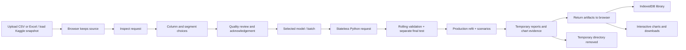
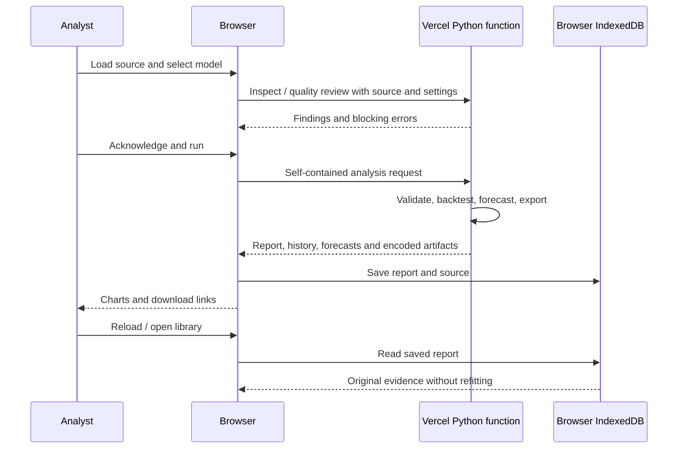
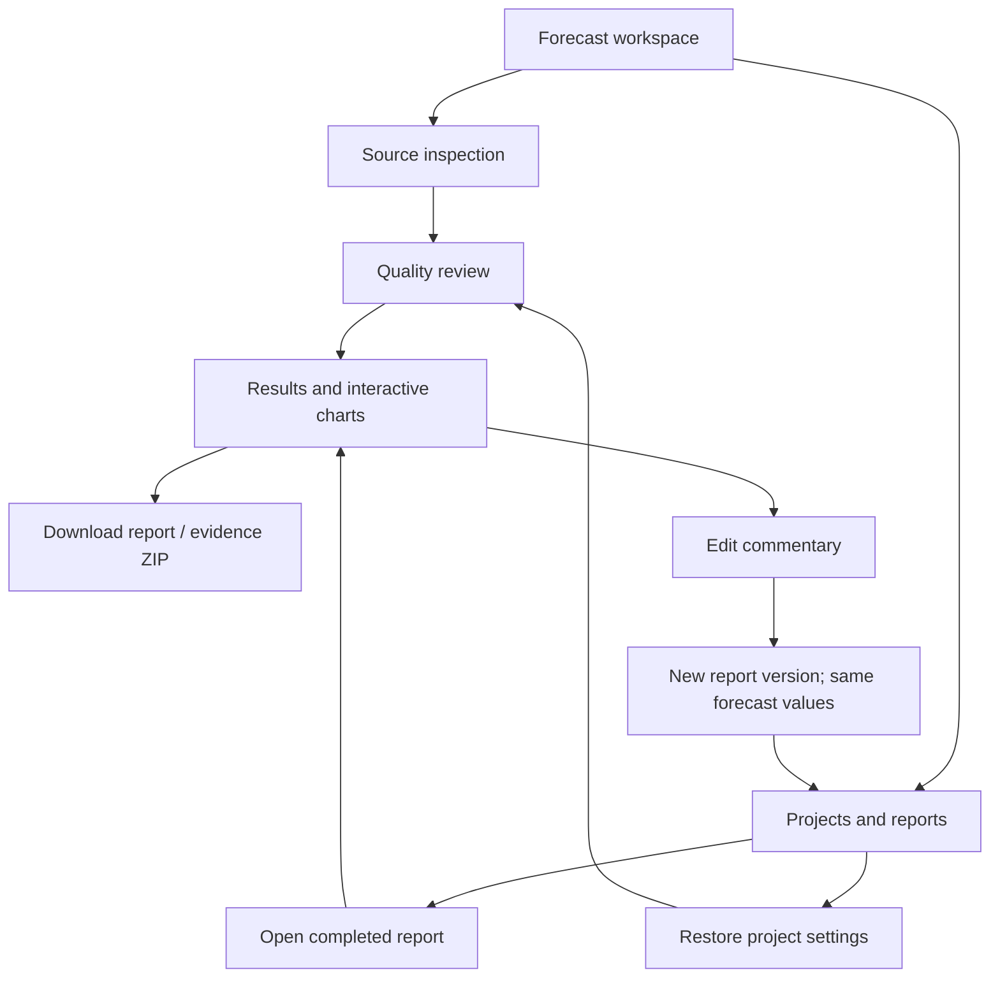

# Hosted application: release 1.1

## Objective and scope

Alphacentauric BI turns a selected numeric time series from CSV/Excel into chronological validation, forecasts, scenarios, interactive charts and reproducible reports. It helps analysts inspect evidence and assumptions. It cannot certify uploaded source credibility, universal market coverage or forecast precision.

The hosted application is a stateless Python API on Vercel. It does not need an OpenAI key, a Kaggle key, a database subscription or paid AI calls. Hosting usage is subject to the owner's Vercel plan and quotas; “zero API tokens” does not mean unlimited free hosting.

## Beginner instructions

1. Open the production URL listed at the top of README.
2. Click **Load Kaggle retail sales** to try historical observed retail records, or select a CSV/XLSX/XLS file and click **Inspect uploaded file**.
3. Confirm the time column, numeric value, units, frequency and aggregation. Filter every remaining market dimension or deliberately permit combining comparable segments.
4. Select ARIMA, SARIMA, another named model, or Compare all. Seasonal models need sufficient seasonal history. Supply historical and future numeric driver values for SARIMAX.
5. Click **Review data quality**, read the findings, resolve blocking errors and acknowledge the warnings. Settings changes invalidate acknowledgement.
6. Click **Analyze market & forecast**. Keep this tab open while the request finishes. Examine final-test errors versus the naive baseline, interval coverage and limitations.
7. Expand charts, toggle series, zoom, inspect values and download SVGs. Download PDF, HTML, R Markdown, R verification, CSV, JSON or the full evidence ZIP.
8. Use **Save project settings & source** and **Projects & reports** to reopen your browser's saved work. Source, settings and reports stay in this browser profile on this domain. They are not synchronized with another device.
9. Edit analyst commentary to generate a new report version with the original numerical evidence. Clearing site storage, private browsing expiry or **Clear browser workspace** can delete saved work. Download evidence bundles as backups.

### Input rules

- Hosted file limit: 3 MiB; local dashboard: 10 MiB. The lower hosted limit allows base64 JSON to fit platform payload limits.
- UTF-8 CSV, XLSX or XLS; up to 250 columns in hosted mode. Wide tables need recognizable year/date column headers.
- Maximum 2,000 regular aggregated periods in hosted mode; forecast horizon 1–36; interval level 80%, 90% or 95%; rolling folds 3–6.
- Excel archives have an expanded-size bound. Missing observations must be resolved or explicitly carried forward; absent rows are not automatically zero sales.
- Mixed currencies/units block analysis. Aggregate totals must not be combined with their component rows.
- Batches support 1–12 groups, subject to a 4 MB result bound and the host's runtime limit. For large batches, reduce groups or use local mode.
- Model selection uses historical rolling windows; the separate final test is excluded from selection/calibration. The final production fit can then use all observations.
- Negative lower bounds are retained and visible. They are a modeling limitation, not plausible negative market demand. Scenario paths are assumptions, not probabilities.

## Kaggle dataset and freshness

[Superstore Sales Dataset by rohitsahoo](https://www.kaggle.com/datasets/rohitsahoo/sales-forecasting) was downloaded from Kaggle, not copied from an unrelated mirror. Source metadata records GPL 2, last updated 2020-09-11, with order dates during 2015–2018. This is historical educational retail data; forecasts made from it are historical exercises, not current 2026 market estimates. Source currency is not independently verified.

The 9,800 source order lines are grouped into 573 monthly region/category rows. Customer names, IDs, addresses and detailed product/transaction information are excluded. Some category/region series begin later than January 2015. The app does not fabricate leading observations. `order_lines` counts rows, not distinct orders. Source URL, retrieval time, transformations and hashes are in `src/alphacentauric_bi/data/kaggle_retail_source.json`. Attribution and the source data license are included.

To refresh intentionally, with network access:

```sh
python tools/prepare_kaggle.py
python -m unittest discover -s tests -p 'test*.py'
```

Review changes in the source hash, licensing, schema and model results before committing. Refreshing downloads the current Kaggle version and rebuilds the derived snapshot; there is no undisclosed live refresh or scraping task. The World Bank import CLI is an additional explicit data source and does not claim sector market-size coverage.

## Run the hosted architecture locally

Python 3.12 is required. No credentials or replacement secrets are required.

```sh
python3.12 -m venv .venv
source .venv/bin/activate
python -m pip install -r requirements-dev.txt
python -m uvicorn app:app --host 127.0.0.1 --port 8015
```

On Windows use `py -3.12 -m venv .venv` and `.venv\Scripts\Activate.ps1`. Then open `http://127.0.0.1:8015`.

The original persistent local dashboard remains available with `python run.py`. It uses `var/` for data. Optional account mode belongs to one shared server workspace; it is **not** multi-tenant SaaS. Accounts can be created/reset with:

```sh
PYTHONPATH=src python -m alphacentauric_bi.security --data-dir var --name analyst --role analyst
BI_AUTH_REQUIRED=1 python run.py
```

Passwords are prompted, hashed with scrypt, and never placed in these commands. Owner/analyst/viewer roles apply to this one deployment workspace. Separate customers require separate deployments until independently tested tenant isolation exists. Use HTTPS and secure cookies for remote account mode. The hosted browser-library app does not use this local account database.

## Data and navigation flows







No server library is shared between visitors. Browser state is isolated by browser profile/origin, not by a cloud account. Other people using the same browser profile can see its saved data. Uploads are transmitted to the server for computation; avoid sensitive records unless the deployment's privacy terms and controls are appropriate.

## Docker execution

```sh
docker compose up --build
```

Open `http://127.0.0.1:8000`. Docker serves the same stateless/browser-library architecture as Vercel using Uvicorn. Set `BI_PORT` to change the host port; the container always listens on 8000. The named data volume remains available for operators who explicitly select local/server mode, but the default hosted application stores projects in the browser. This fixes the earlier container startup conflict between non-loopback binding and local account requirements.

## Tests and release process

```sh
python -m unittest discover -s tests -p 'test*.py'
npm ci
npx playwright install chromium
# Start uvicorn on port 8015 in another terminal first.
npm run test:e2e
# For a deployed URL:
BASE_URL=https://your-production-domain.vercel.app npm run test:e2e
```

CI runs Python and browser tests on Ubuntu. Vercel deploys the Git repository. Stage the production build without assigning domains, inspect build/runtime logs and exercise it, then promote the tested deployment. Never commit `.env*`, `.vercel`, uploaded private files, runtime account databases or browser storage dumps.

The initial local server architecture cannot simply run unchanged in serverless functions: process-memory dataset IDs, daemon jobs and local report files are not reliable shared persistence. The hosted transport instead makes each request self-contained, completes analysis during the request, removes temporary files and persists returned artifacts in browser storage. See [Vercel Python documentation](https://vercel.com/docs/functions/runtimes/python) and [platform limits](https://vercel.com/docs/functions/limitations).

## Remaining commercial boundaries

This release supports public use within hosted request, file, computation and browser-storage limits. It is not an enterprise multi-tenant service. Shared cloud accounts, cross-device synchronization, database tenant isolation, durable queues for jobs exceeding one request, external object storage for large files, organization collaboration, billing, SSO/MFA, usage metering and provider-independent offsite recovery remain separate work. Privacy/terms, support ownership and a source-code licensing decision require the business owner's decisions. Hosted Kaggle forecasting does not establish reliable forecasts for every industry/country/state. R files are generated; R/Pandoc execution needs an R-enabled environment. Docker startup still requires a running Docker daemon and Compose.
